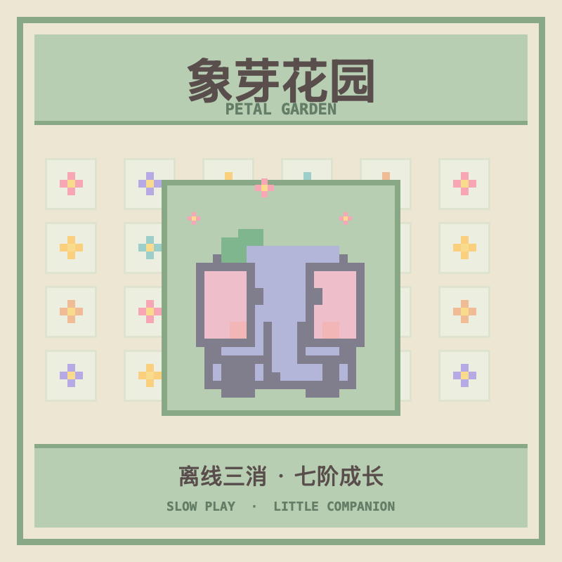

<p align="right"><a href="README.zh_CN.md">简体中文</a> · <strong>English</strong></p>

# Xiangya Petal Garden for AI Passport

An offline, unhurried match-three game for the FoloToy AI Passport. Match three flowers to help a small pixel elephant grow. There are no countdowns, daily tasks, stamina limits, network accounts, servers, or large language models.

This standalone source package is adapted from the [FoloToy AI Passport](https://github.com/FoloToy/ai-passport) ESP32-C3 firmware baseline. The game screen opens at startup. Generated firmware is excluded from Git.



## Play

- Use **UP/DOWN** to select a flower, then **OK**. Use **UP/DOWN** to choose an adjacent flower and **OK** again to swap. Only a swap creating a line of three or more identical flowers clears them.
- The seven companion stages unlock after 0, 60, 180, 360, 600, 960, and 1440 cumulative cleared flowers. Their on-screen Chinese names are listed in the Simplified Chinese README. The seventh stage is the largest form. Play can continue after it. Existing saves keep their unlocked form and actual cleared-flower count when upgraded. If a legacy save is already at stage seven but has fewer than 1440 flowers, its progress bar keeps advancing toward 1440.
- **Long OK** opens a visual growth preview at stage 2. **UP/DOWN** browse stages 2–7; **OK** returns to the game. Preview does not change saved progress.
- **Long DOWN** opens manual date and time setting. In that screen, UP/DOWN change a value, OK moves to the next field, long OK saves, and long DOWN cancels. The game itself does not require internet access.
- **Long UP** toggles sound. Game progress is saved locally after a valid match.

## Build

Target hardware: AI Passport with ESP32-C3, 8 MB Flash, 240 × 320 display, and three buttons. Use ESP-IDF **5.5.3** and activate its environment, then run:

```sh
./tools/validate.sh
```

The complete gate runs host tests, builds the firmware, verifies the partition layout, and creates `build/FoloToy-AI-Passport-full.bin`. The merged `full.bin` is the image for a complete flash at `0x0`; `build/FoloToy-AI-Passport.bin` is only the application image and must not be written at `0x0`. A complete merged flash can overwrite saved data. See [firmware layout and data preservation](https://github.com/FoloToy/ai-passport/blob/main/docs/development/engineering/firmware-layout.md).

To upgrade from an earlier build of this game while keeping the save, confirm that the device uses this repository's partition table and flash only the app partition with `idf.py -p <port> app-flash`. Do not write the merged image at `0x0` for a save-preserving upgrade. Back up the save first when possible; this upgrade path still needs device validation.

The Chinese name font is a small Source Han Sans SC subset generated from LVGL's bundled source font under the SIL Open Font License 1.1. Its generation command and source are recorded in [assets/fonts/garden_name_16.c](assets/fonts/garden_name_16.c) and [assets/README.md](assets/README.md). The repository code follows the root [MIT license](LICENSE).
