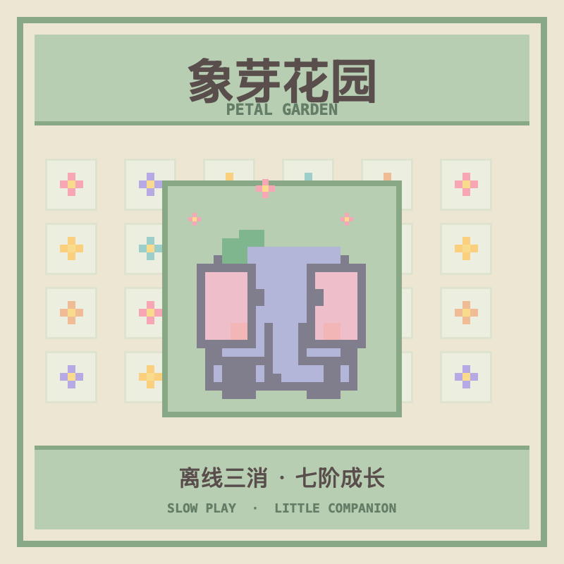

<p align="right"><strong>简体中文</strong> · <a href="README.md">English</a></p>

# AI Passport 象芽花园

一款运行在 FoloToy AI Passport 上的离线、慢节奏三消小游戏。消除同色花朵，陪像素小象长大。没有倒计时、每日任务、体力限制、网络账号、服务器或大模型。

这份独立源码基于 [FoloToy AI Passport](https://github.com/FoloToy/ai-passport) 的 ESP32-C3 固件底座开发，启动后进入游戏自己的界面。仓库提供可构建和审查的源码，不将生成的固件提交到 Git。



## 玩法与按键

- 按**上/下键**选中一朵花，按 **OK**；再按上/下键选择相邻花朵，按 **OK** 交换。交换后形成连续三朵或更多同色花才会消除。
- 累计消除达到 0、24、60、108、168、240、324 朵时，依次进入七个阶段：象芽、小耳朵、稳稳站、卷鼻子、一朵花、花冠象、七彩花冠象。第七阶段体型最大，之后仍可继续玩。
- **长按 OK** 从第二阶段进入成长预览，按上/下键浏览第二至第七阶段，短按 **OK** 返回游戏。预览不会改变存档进度。
- **长按下键**进入日期时间设置；设置页中上/下键调整数值，OK 切换字段，长按 OK 保存，长按下键取消。游戏不需要联网。
- **长按上键**切换音效。有效消除后，游戏进度保存在本地。

## 构建

目标设备为 ESP32-C3、8 MB Flash、240 × 320 屏幕和三个按键的 AI Passport。激活 **ESP-IDF 5.5.3** 环境后运行：

```sh
./tools/validate.sh
```

完整验证会运行主机测试、构建固件、核验分区布局，并生成 `build/FoloToy-AI-Passport-full.bin`。完整刷写应使用从 `0x0` 写入的合并镜像 `full.bin`；单独的应用镜像 `build/FoloToy-AI-Passport.bin` 不可写在 `0x0`。完整合并镜像可能覆盖存档数据，详见[固件分区与数据保留说明](https://github.com/FoloToy/ai-passport/blob/main/docs/development/engineering/firmware-layout.zh_CN.md)。

中文名称字库是从 LVGL 随附的思源黑体简体字型提取的小型子集，使用 SIL Open Font License 1.1。生成命令和来源记录在 [assets/fonts/garden_name_16.c](assets/fonts/garden_name_16.c) 与[素材说明](assets/README.zh_CN.md)。仓库代码遵循根目录的 [MIT 许可](LICENSE)。
